# Folio

**Notes, docs and project plans, right inside ERPNext.**

Folio is a workspace in the style of Notion, built as a Frappe app. Your team writes
pages, plans projects and tracks tasks in one place, and every project and task in
Folio *is* the real ERPNext record. Nothing is copied, nothing has to be synced, and
the same people see the same things as in ERPNext.

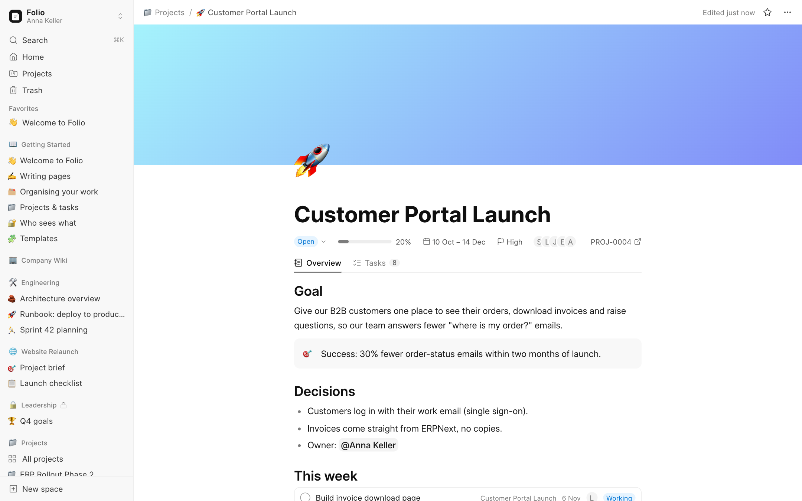

---

## The story: one week at a small company

Meet the team at a small company that runs on ERPNext:

- **Anna** leads operations. She plans the projects.
- **Luca** and **Jonas** are engineers.
- **Sophie** designs, **Elena** looks after customers.

Before Folio, the project plan lived in a Google Doc, the task list in ERPNext, and the
meeting notes in someone's inbox. Nobody was sure which one was up to date.

### Monday: Anna starts a project

Anna clicks **New project** in Folio and types *Customer Portal Launch*, with a start
and end date. Folio creates the project **in ERPNext** and, at the same moment, gives
it its own **page**.

The top of the page always shows the live facts from ERPNext: status, how far along it
is, the dates, the priority and who's involved. Below that, the **Overview** is a
normal page where Anna writes the goal, the decisions and anything else the team
should know.

> **Example:** Anna writes *"Success: 30% fewer order-status emails within two months"*
> in a callout box, so it's the first thing anyone opening the project reads.

### Tuesday: the work gets split up

On the **Tasks** tab, Anna types each piece of work and presses Enter. Every line is a
real ERPNext Task in this project, so it also shows up in ERPNext's task list,
timesheets and reports.

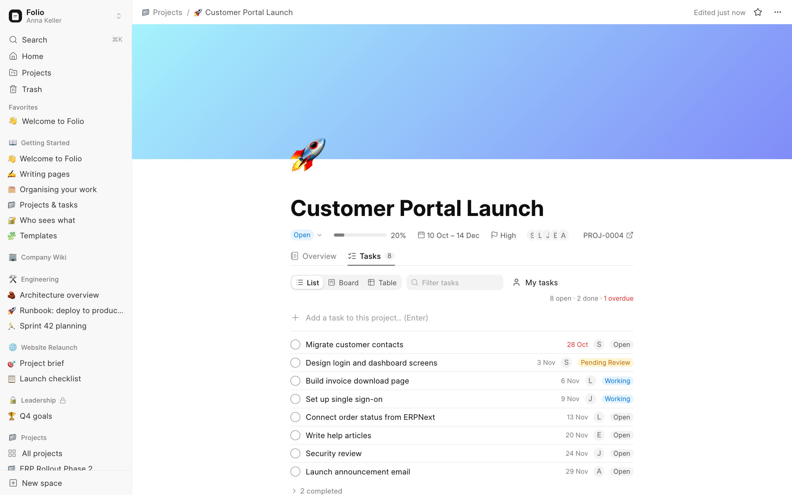

### Wednesday: stand-up on the board

In the stand-up, the team switches the Tasks tab to **Board**. Each column is a status:
*Open*, *Working*, *Pending Review*, *Completed*. When Luca starts on the invoice page,
he drags its card to *Working*, and the task is updated in ERPNext straight away.

A task that is past its due date gets a **red flag**, so nobody has to go looking for
what's late.

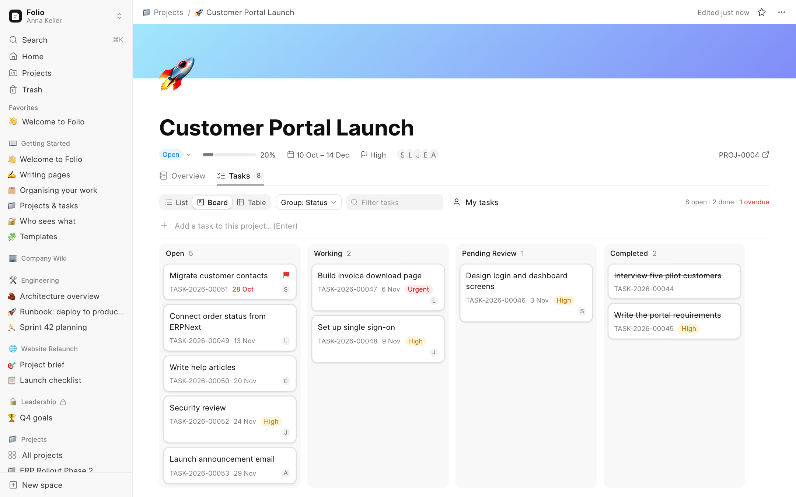

Anna wants to see who's carrying what, so she switches **Group: Assignee**. Now each
column is a person. Dragging a card from Luca to Jonas re-assigns the task.

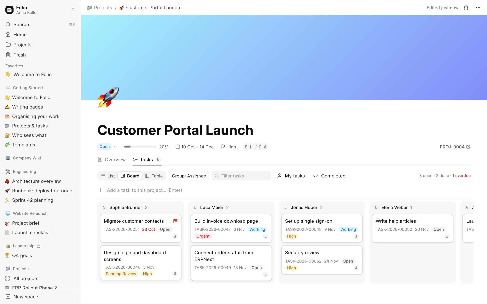

Clicking any card opens the **task panel** on the right: change the title, status,
people, priority, dates or write a description. Folio won't let you pick a due date
after the project's end date, because ERPNext wouldn't accept it either, and if
ERPNext ever refuses a change, Folio shows you ERPNext's own message.

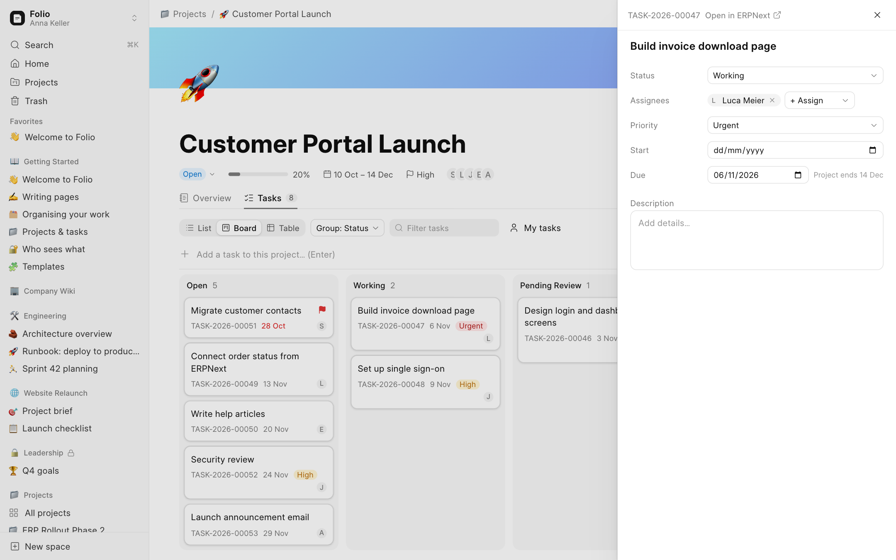

For a quick scan, the **Table** view lists every task and sorts by any column.

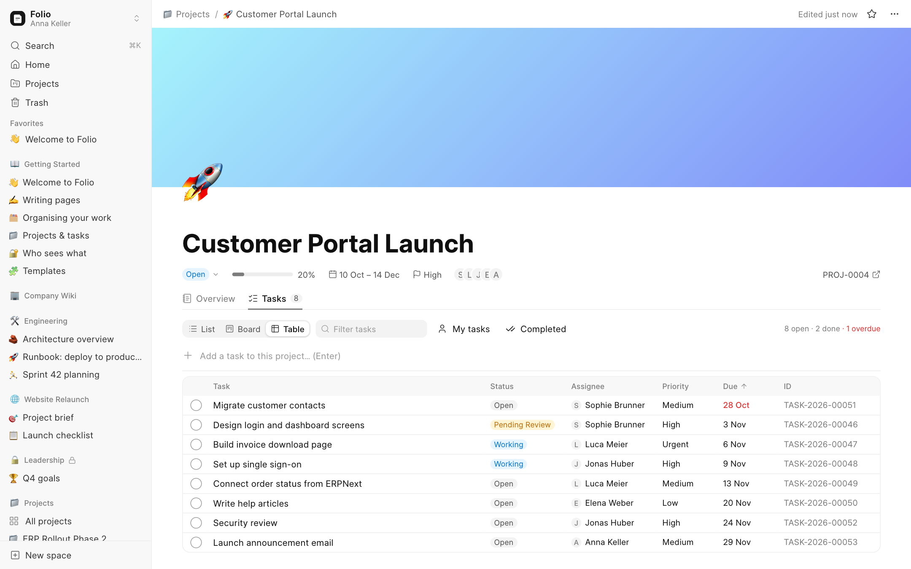

### Thursday: the weekly meeting

Elena takes the meeting notes in Folio. She types `@` to mention people, ticks off
action items, and types `/project` to drop in a live card of the portal project. The
card shows its progress and how many tasks are open. It updates by itself, so the
notes never go stale.

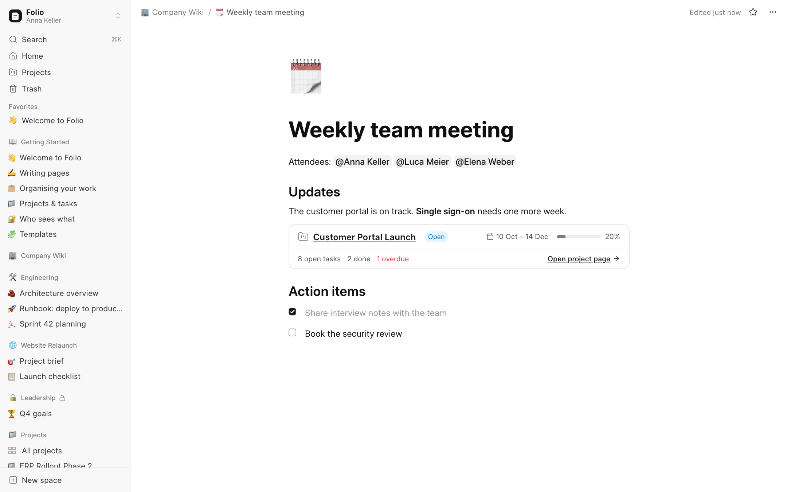

Writing feels like Notion: type `/` for any kind of block, or use shortcuts like `#`
for a heading and `[]` for a checkbox.

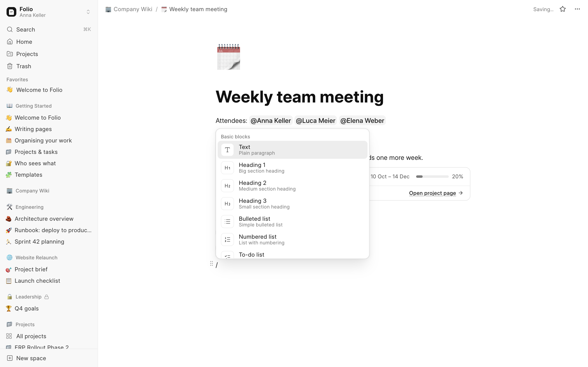

Select some text and a small toolbar appears for bold, italic, highlight, links and
more.

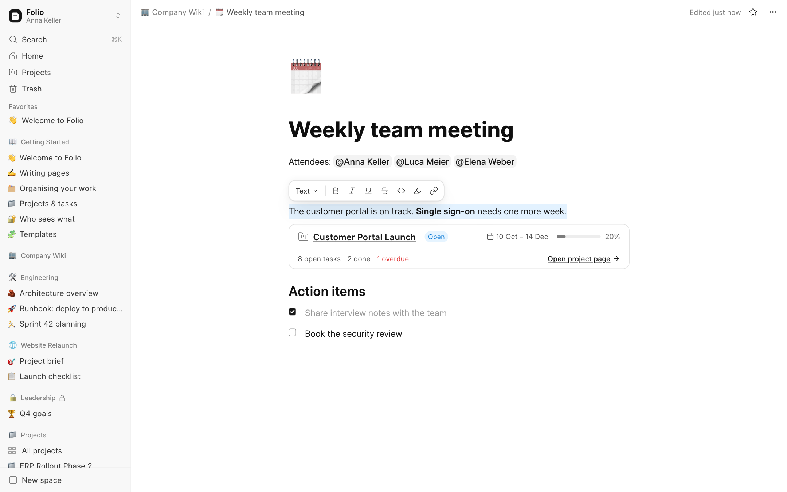

### Friday: where do we stand?

Anna opens **All projects** for the bird's-eye view: every project with its status,
progress, dates, open and overdue tasks, and team.

> **Example:** *ERP Rollout Phase 2* shows **4 overdue** in red. Anna opens it and sees
> at once which tasks slipped.

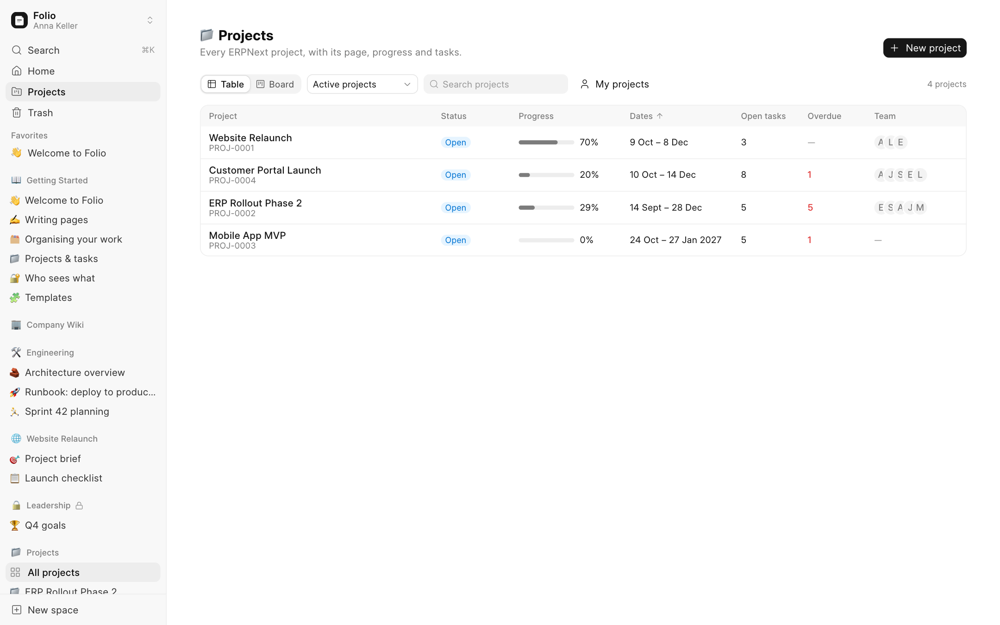

The same list works as a board by project status. Dragging a project to *On hold*
updates it in ERPNext.

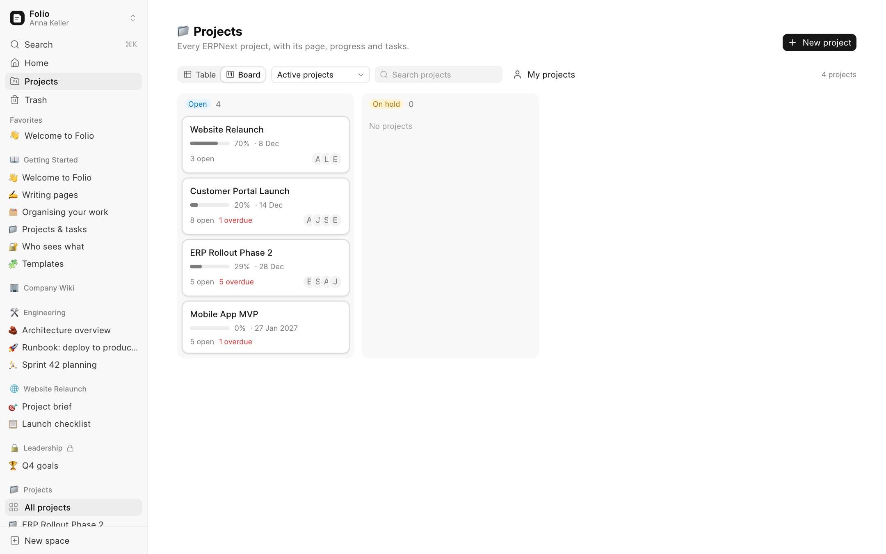

And whenever someone is looking for something, **⌘K** searches every page they're
allowed to see, titles and text.

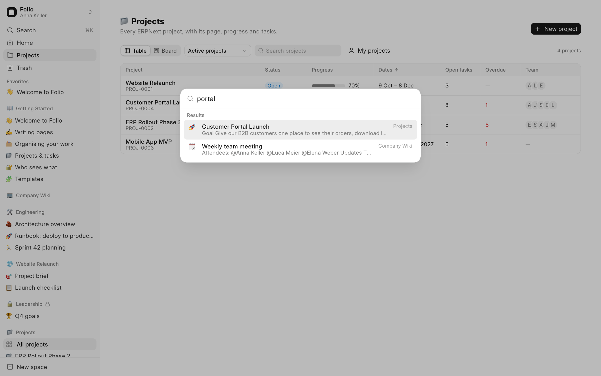

---

## Who sees what

Folio doesn't have its own user system. It uses **Frappe's users, roles and
permissions**, so whoever administers ERPNext already knows how to manage it.

### Spaces: rooms for teams

Pages live in **spaces**, like *Company Wiki*, *Engineering* or *Leadership*. Each space
is either open to everyone in the company or private to its members. Members get one of
three levels:

| Level | Can do |
|---|---|
| **Full Access** | Everything, including the space's settings and members |
| **Can Edit** | Write and organise pages |
| **Can View** | Read only |

> **Example:** *Leadership* is a private space. Anna has Full Access and Marco can only
> view it. Everyone else doesn't even see that it exists.

Settings and members are one click away (**⋯** next to the space in the sidebar). A
space can never lose its last Full Access member, so nobody locks everyone out by
accident.

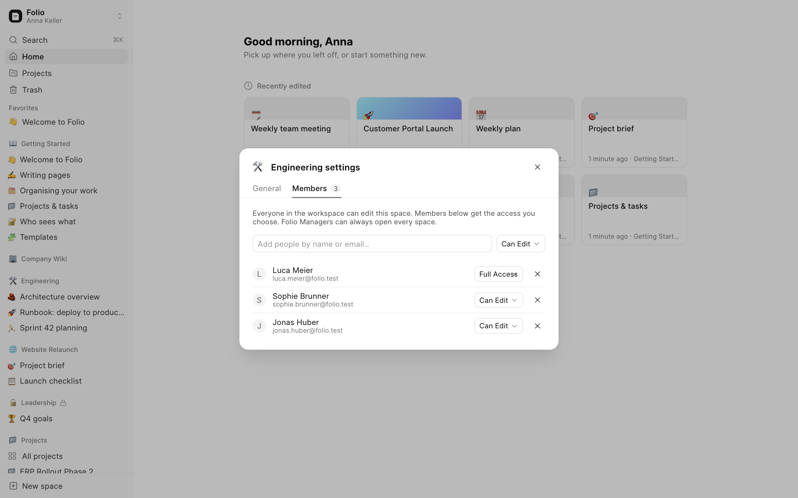

### Projects: exactly what ERPNext allows

A project's page, and every page under it, follows **ERPNext's permission on that
project**:

| In ERPNext, the person… | In Folio, they… |
|---|---|
| can't see the project | don't see its page anywhere, not in the sidebar, search or links |
| can see it but not edit it | can read its page but not change it |
| can see and edit it | can work on it normally |

> **Example:** a freelancer joins to help with the customer portal only. The admin
> gives them the *Projects User* role and one ERPNext **User Permission**: *Project =
> Customer Portal Launch*. In Folio, they see that one project and nothing else.

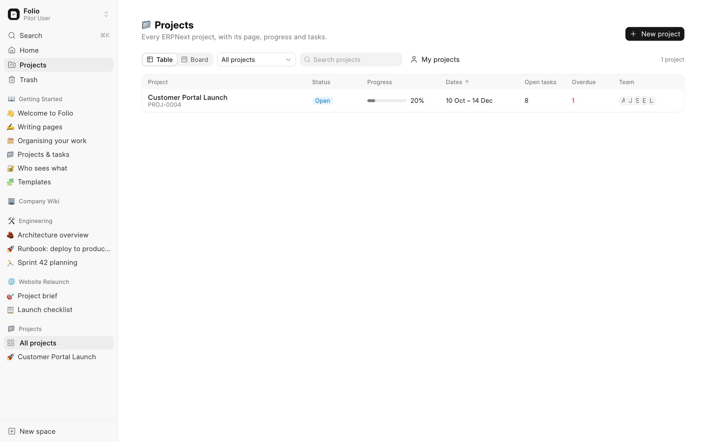

If they follow an old link to another project, Folio simply says the page isn't
available.

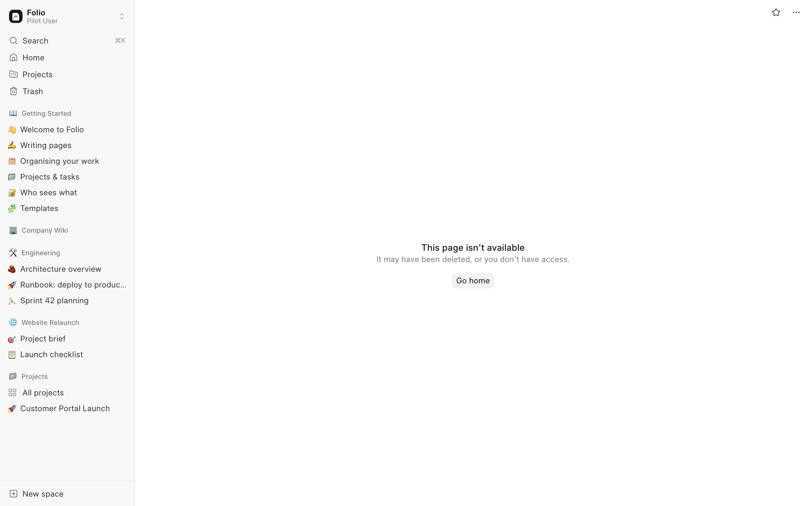

**Good to know:** in ERPNext, every *Projects User* can see every project by default.
Being on a project's team doesn't limit that. To limit someone, add Project User
Permissions as in the example. The [admin guide](docs/admin.md) walks through it.

---

## Learning Folio

New people don't start from a blank screen. Folio comes with a **Getting Started**
space: a welcome page with a 5-minute tour, guides on writing, organising, projects
and permissions, and templates for meeting notes, project briefs and weekly plans.
Open a template, choose **••• → Copy to…** and pick your space.

## Everything Folio does

The short version (the full list is in [docs/features.md](docs/features.md)):

- **Pages**: nest pages inside pages, drag them around, star favourites, emoji icons
  and covers, full-width and locked pages.
- **Editor**: headings, lists, checklists, quotes, callouts, code with colours, tables,
  images (paste or drop), links, `@mentions`, sub-pages, the `/` menu, drag handles.
- **Safety nets**: saves as you type, warns you if someone else changed the page, a
  version history you can restore, and a trash for deleted pages.
- **Projects**: a page for every ERPNext project with a live header, Overview, and
  Tasks as list, Kanban board (by status, person or priority) or table, plus a task
  panel for editing.
- **All projects**: every project at a glance, as a table or board, with "My
  projects", search, and New project.
- **Tasks anywhere**: `/task` in any page creates or links a real ERPNext task;
  `/project` adds a live project card.
- **Access**: spaces with members, and project pages that follow ERPNext's own
  permissions.

---

## Try it

You need a [Frappe](https://frappe.io/framework) v16 site. ERPNext is optional: without
it you get pages and spaces; with it you also get projects and tasks.

```bash
bench get-app https://github.com/eagleautomate/folio
bench --site <site> install-app folio
bench build --app folio
```

Open `https://<your-site>/folio`.

Want to look around first? Load the demo company (people, spaces, pages, projects and
tasks) on a **test site**:

```bash
bench --site <site> execute folio.demo.seed.run
```

Then log in as `anna.keller@folio.test` with the password `admin12345!`. Don't run the
demo on a site with real data.

## Learn more

| | |
|---|---|
| [docs/features.md](docs/features.md) | The full feature list |
| [docs/admin.md](docs/admin.md) | Setting up Folio and controlling who sees what |
| [docs/roadmap.md](docs/roadmap.md) | What's done and what's coming |
| [docs/architecture.md](docs/architecture.md) | How it works inside (for developers) |
| [AGENTS.md](AGENTS.md) | Commands, conventions and tests for contributors and AI coding assistants |

The screenshots come from the demo data and are made by `frontend/e2e/screenshots.mjs`,
so they can be refreshed with one command.

## License

MIT
